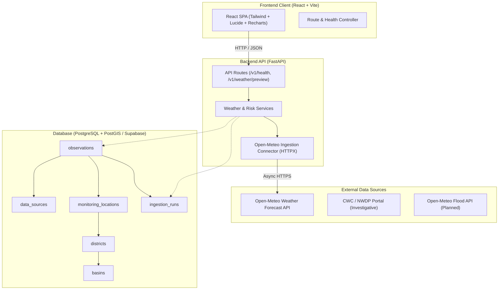

# FloodWatch System Architecture

This document details the architectural design, component boundaries, physical measurement taxonomy, database design, and security model of **FloodWatch**.

---

## 1. High-Level Architecture Overview

---

## 2. Separation of Concerns

The backend architecture strictly separates concerns across layered modules:

1. **API Routers (`app/api/v1/routes/`)**:
   - Handle HTTP deserialization, query parameters, coordinate bounding validation (`-90 <= lat <= 90`, `-180 <= lon <= 180`).
   - Map domain exceptions to standardized HTTP status codes (422 for malformed requests, 504 for timeouts, 502 for upstream provider failures, 500 for unhandled exceptions).
   - Zero direct upstream network calls; delegates entirely to the service layer.

2. **Service Layer (`app/services/`)**:
   - Coordinates business logic, coordinate presets, and aggregation.
   - Decoupled from HTTP protocol details, allowing reuse in background worker tasks or CLI scripts.

3. **Ingestion Connectors (`app/ingestion/`)**:
   - Encapsulate HTTP client calls via `httpx.AsyncClient`.
   - Implement timeout policies, provider retry configurations, and schema normalization.
   - Transform external provider JSON responses into strongly-typed Pydantic schemas.

4. **Database & Persistence (`app/db/`, `database/migrations/`)**:
   - Migrations written in raw, declarative SQL targeting PostgreSQL 15+ and PostGIS.
   - No automatic or uncontrolled schema modifications at runtime.

---

## 3. Physical Measurement Taxonomy & Invariant Rules

Hydrological and meteorological data involve distinct physical phenomena that must **never** be conflated:

### A. Observation Types (Scientific Taxonomy)
- `observed`: Real-time or historical physical telemetry measured by in-situ ground instrumentation (e.g. CWC or IMD automatic weather stations).
- `analysis`: Real-time model-derived nowcast / gridded atmospheric interpolation (e.g., Open-Meteo current precipitation). Never conflated with physical station telemetry.
- `forecast`: Predictive values generated by numerical weather prediction (NWP) or hydrological forecast models with a future time horizon. `forecast_reference_time = NULL` when provider omits model run timestamp.
- `reanalysis`: Historical gridded climate reanalysis (e.g., ERA5 archive).
- `simulation`: Scenario-based hydrodynamic flood routing runs or hypothetical dam release simulations.

### B. Ingestion Pipeline & Persistence Architecture
1. **Pooled HTTPX Connections (`app/core/http_clients.py`)**: FastAPI `lifespan` initializes and cleanly closes shared `httpx.AsyncClient` connection pools for Supabase PostgREST and Open-Meteo endpoints.
2. **Open-Meteo Connector (`app/ingestion/open_meteo.py`)**: Configured with bounded exponential backoff and retries on transient HTTP 5xx, rate-limit, or network errors. Fast abort on permanent 4xx errors.
3. **Persistence Strategy (`app/db/supabase_client.py`)**:
   - Primary: Stored procedure `public.upsert_weather_observations` (Migration 003) targeting partial unique indexes `uq_observations_analysis` and `uq_observations_forecast_active`.
   - Secondary (non-production fallback): Client-side reconciliation via PostgREST lookup and targeted PATCH/POST, preserving trigger activation.
4. **Audit History & Trigger**: PostgreSQL trigger `trg_observations_forecast_revision` captures prior active forecast predictions into `forecast_observation_revisions` whenever a forecast value or unit changes.
5. **Dual Data Freshness Engine (`app/services/data_quality.py`)**:
   - Physical observation freshness (`valid_at`): `fresh <= 120m`, `delayed <= 360m`, `stale > 360m`, `unavailable`.
   - Pipeline retrieval freshness (`fetched_at`): `fresh <= 60m`, `delayed <= 180m`, `stale > 180m`, `unavailable`.
   - Missing or invalid timestamps classify as `unavailable` and zero precipitation is never confused with missing data.
6. **Risk, Alert & Reporting Services (`app/services/`)**: Coordinates concurrent bounded (`asyncio.Semaphore(5)`) telemetry fetches, rainfall runoff categorization, alert deduplication (`NEW -> ACTIVE -> ACKNOWLEDGED -> RESOLVED`), and IST reporting/CSV exports.

### B. Measurement Types and Physical Constraints
| Measurement Type | Physical Phenomenon | Canonical Unit | Value Constraints | Hydraulic Rationale |
| :--- | :--- | :--- | :--- | :--- |
| `rainfall` | Precipitation accumulation | `mm` | $v \ge 0$ | Atmospheric depth cannot be negative. |
| `water_level` | River stage / surface elevation | `m` | Any real number | **Datum-dependent:** River stage is referenced against a local station gauge datum or mean sea level (MSL). Water level readings can legitimately be negative if the stage falls below the local zero-datum mark. Therefore, **no positive-only constraint is imposed**. |
| `discharge` | Volumetric flow rate | $m^3/s$ (cumecs) | $v \ge 0$ | Measures the volume of water passing through a river cross-section per second. |

### C. Critical Rule: Segregation of Discharge and Stage
> **IMPORTANT:** River discharge ($m^3/s$) must **NEVER** be compared directly against stage/water-level danger levels ($m$).
> A danger level (e.g., 26.5 m at Naraj or 12.0 m at Paradeep) is a spatial elevation metric indicating bank overtopping risk. Discharge is volumetric rate governed by channel geometry and velocity ($Q = A \times V$). Discharge can only be related to stage through site-specific, non-linear rating curves ($Q = C(h - h_0)^N$).

---

## 4. Database Schema & PostGIS Modeling

The relational model stores spatial geometries using EPSG:4326 (WGS 84):
- **`districts`**: Stores polygon boundaries and centroid points using PostGIS `GEOMETRY(Point, 4326)`.
- **`monitoring_locations`**: Stores geospatial coordinates (`Point, 4326`), explicit `latitude` and `longitude` fields with check constraints, and flags distinguishing official stations from sample test coordinates (`is_official_gauge`).
- **`observations`**: High-volume timeseries table capturing physical metrics across multiple temporal dimensions (`valid_at`, `fetched_at`, `created_at`, and optional `forecast_reference_time`). Indexed with compound index on `(location_id, measurement_type, observation_type, valid_at DESC)` and partial unique deduplication indexes. Enforces database-level check constraints on measurement types, units, and non-negative physics.

---

## 5. Security Model & Data Protection

1. **Environment Configuration**: Sensitive secrets (database passwords, upstream API keys) reside exclusively in `backend/.env`. A sanitised template is provided in `backend/.env.example`.
2. **Supabase Key Segregation**: The Supabase `service_role` key grants administrative bypass privileges and is strictly confined to backend execution. It is **never** embedded or transferred to the frontend client.
3. **Row Level Security (RLS)**:
   - RLS is explicitly enabled on all tables (`basins`, `districts`, `data_sources`, `monitoring_locations`, `ingestion_runs`, `observations`).
   - Public/anonymous access is restricted to read-only queries on public reference entities (`districts`, `basins`, `data_sources`).
   - All mutation operations (`INSERT`, `UPDATE`, `DELETE`) require authenticated service-role privileges.
